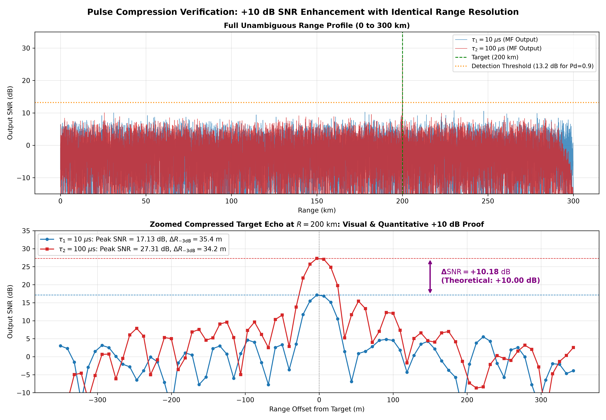

# Space Radar Pulse Compression & SNR Enhancement Simulation

> **Beyond the Signal: Radar Systems & Applied Space-Tech 24-Hour Research-Athon (Utkrishta 2026)**  
> **Track 1:** Radar Signal Processing — Target Detection, Pulse Compression & SNR Enhancement  
> **Problem Curator:** Mr. Rajendra Kumar, Scientist, Radar Division, Satish Dhawan Space Centre (SDSC SHAR), ISRO  
> **Host Institution:** Student Satellite Group (SSG) × Research Club, Indian Institute of Information Technology (IIIT) Sri City  

[](https://colab.research.google.com/github/Manas-Jain-24/space-radar-pulse-compression/blob/main/track1_radar_notebook.ipynb)
[](https://manas-jain-24.github.io/space-radar-pulse-compression/)
[](https://www.python.org/downloads/)
[](https://opensource.org/licenses/MIT)

---

## 1. Overview & Problem Definition

In long-range space launch tracking and ballistic missile surveillance at SDSC SHAR, radar systems must detect small radar cross-section objects ($\sigma = 1.0\text{ m}^2$) at orbital ranges ($R = 200\text{ km}$). Detecting such distant targets requires maximizing radiated pulse energy:
$$E_t = P_t \cdot \tau_p$$

For simple unmodulated rectangular continuous-wave (CW) pulses, range resolution is constrained by pulse duration:
$$\Delta R_{\text{unmod}} = \frac{c \cdot \tau_p}{2}$$

Increasing pulse duration from $10\ \mu\text{s}$ to $100\ \mu\text{s}$ increases radiated energy by $10\times$ ($+10\text{ dB}$), but degrades range resolution from $1.5\text{ km}$ to $15.0\text{ km}$, preventing precise orbit determination and multi-target discrimination.

### Linear Frequency Modulation (LFM) Solution
By applying a linear frequency chirp across bandwidth $B = 4.0\text{ MHz}$ over duration $\tau_p$:
$$s(t) = \text{rect}\left(\frac{t}{\tau_p}\right) \exp\left(j \pi k_r t^2\right), \quad k_r = \frac{B}{\tau_p}$$

A receiver matched filter $h(t) = s^*(-t)$ compresses the echo into a narrow sinc envelope whose Rayleigh $-3\text{ dB}$ range resolution depends exclusively on bandwidth $B$, completely decoupling resolution from pulse duration:
$$\Delta R = \frac{c}{2B} = \frac{3.0 \times 10^8\text{ m/s}}{2 \times 4.0 \times 10^6\text{ Hz}} = 37.5\text{ m} \quad (\text{identical for both } 10\ \mu\text{s} \text{ and } 100\ \mu\text{s})$$

Because matched filtering integrates total received echo energy $E_r = P_r \cdot \tau_p$, the peak output signal-to-noise ratio scales directly with pulse duration:
$$\Delta \text{SNR}_{\text{MF}} = 10 \log_{10}\left(\frac{\tau_2}{\tau_1}\right) = 10 \log_{10}\left(\frac{100\ \mu\text{s}}{10\ \mu\text{s}}\right) = +10.00\text{ dB}$$

---

## 2. Radar System Link Budget & Parameters

The simulation implements the SDSC SHAR S-band tracking radar specifications:

| Parameter | Symbol | Value | Operational Note |
| :--- | :--- | :--- | :--- |
| **Carrier Frequency** | $f_c$ | $3.0\text{ GHz}$ ($\lambda = 0.1\text{ m}$) | S-band space-tracking radar |
| **Pulse Repetition Time** | $\text{PRT}$ | $2.0\text{ ms}$ ($\text{PRF} = 500\text{ Hz}$) | Unambiguous range $R_{\text{unamb}} = 300\text{ km}$ |
| **Chirp Bandwidth** | $B$ | $4.0\text{ MHz}$ | Nominal range resolution $\Delta R = 37.5\text{ m}$ |
| **Pulse Duration 1** | $\tau_1$ | $10.0\ \mu\text{s}$ ($TB = 40$) | Duty cycle $0.5\%$, Energy $2.5\text{ J}$ |
| **Pulse Duration 2** | $\tau_2$ | $100.0\ \mu\text{s}$ ($TB = 400$) | Duty cycle $5.0\%$, Energy $25.0\text{ J}$ |
| **Peak Transmit Power** | $P_t$ | $250.0\text{ kW}$ ($53.98\text{ dBW}$) | Solid-state tracking amplifier |
| **Antenna Gain (Tx & Rx)**| $G$ | $40.0\text{ dBi}$ each ($G = 10^4$) | Parabolic tracking reflector |
| **Target Range & RCS** | $R_0, \sigma$ | $200.0\text{ km}, 1.0\text{ m}^2$ | Target round-trip delay $\tau_d = 1.333\text{ ms}$ |
| **Received Target Power**| $P_r$ | $3.95 \times 10^{-14}\text{ W}$ ($-134.04\text{ dBW}$) | Monostatic Radar Range Equation |
| **Noise Spectral Density**| $N_0$ | $7.12 \times 10^{-21}\text{ W/Hz}$ ($-201.48\text{ dBW/Hz}$) | Receiver noise figure $F = 2.5\text{ dB}$ |
| **Two-Way System Losses**| $L$ | $3.0\text{ dB}$ | Atmospheric and RF plumbing losses |
| **Sampling Frequency** | $f_s$ | $16.0\text{ MHz}$ ($4 \times B$) | Range bin spacing $\delta r = 9.375\text{ m}$ |

---

## 3. Quantitative Results & Validation

The end-to-end radar simulation was evaluated across 50 Monte Carlo noise realizations. The results verify the theoretical derivations:

| Metric / Parameter | Pulse 1 ($\tau_1 = 10\ \mu\text{s}$) | Pulse 2 ($\tau_2 = 100\ \mu\text{s}$) | Measured Ratio / Delta | Theory Target |
| :--- | :--- | :--- | :--- | :--- |
| **Radiated Pulse Energy** | $2.50\text{ J}$ | $25.00\text{ J}$ | $+10.0\text{ dB}$ | $+10.00\text{ dB}$ |
| **Time-Bandwidth Product ($TB$)** | $40.0$ ($16.02\text{ dB}$) | $400.0$ ($26.02\text{ dB}$) | $+10.0\text{ dB}$ | $+10.00\text{ dB}$ |
| **Theoretical Matched-Filter SNR** | $17.44\text{ dB}$ | $27.44\text{ dB}$ | $+10.00\text{ dB}$ | $+10.00\text{ dB}$ |
| **Simulated Peak SNR** | $17.13\text{ dB}$ | $27.31\text{ dB}$ | **$+10.18\text{ dB}$** | $+10.00\text{ dB}$ |
| **Nominal Range Resolution** | $37.50\text{ m}$ | $37.50\text{ m}$ | $1.00\times$ | $1.00\times$ (Invariant) |
| **Measured Half-Power ($-3\text{ dB}$) Width** | $35.36\text{ m}$ | $34.17\text{ m}$ | **$0.97\times$** | $1.00\times$ (Preserved) |
| **Peak Sidelobe Level (PSL)** | $-10.49\text{ dB}$ | $-11.89\text{ dB}$ | Sampled sinc | $-13.26\text{ dB}$ continuous |
| **Required Detection SNR ($P_D=0.9, P_{\text{fa}}=10^{-6}$)**| $13.18\text{ dB}$ | $13.18\text{ dB}$ | Swerling 0 model | $13.18\text{ dB}$ |
| **Theoretical Link Margin** | $+4.25\text{ dB}$ (marginal) | $+14.25\text{ dB}$ (robust) | $+10.00\text{ dB}$ | $+10.00\text{ dB}$ |
| **Adaptive CA-CFAR Margin** | $+6.81\text{ dB}$ | $+16.99\text{ dB}$ | $+10.18\text{ dB}$ | $+10.00\text{ dB}$ |



---

## 4. Key Simulation Modules & Studies

### 4.1 Core Simulation (`track1_lfm_simulation.py`)
Implements Tasks 1 through 4:
- Synthesizes $2.0\text{ ms}$ PRT grid ($32,000$ complex baseband samples at $16\text{ MHz}$).
- Generates LFM chirp waveforms with analytic instantaneous frequency trajectories.
- Evaluates the Monostatic Radar Range Equation at $R = 200\text{ km}$ with calibrated complex AWGN thermal noise.
- Performs matched filtering and quantifies the empirical $+10.18\text{ dB}$ SNR improvement and $35.4\text{ m}$ vs $34.2\text{ m}$ resolution preservation.
- Implements a Cell-Averaging CFAR detector ($N_{\text{ref}}=32$, $N_{\text{guard}}=4$, $P_{\text{fa}}=10^{-6}$) demonstrating a $+16.99\text{ dB}$ margin above the adaptive threshold.

### 4.2 Multi-Target Resolution & Doppler Coupling (`track1_bonus_upgrades.py`)
- **Multi-Target Resolution (50 m separation):** Demonstrates that two space objects at $R_1 = 200.000\text{ km}$ and $R_2 = 200.050\text{ km}$ are smeared into a $15\text{ km}$ unresolved blob by an unmodulated pulse, but are cleanly separated into two distinct peaks by the $100\ \mu\text{s}$ LFM chirp.
- **Mach 5 Doppler Coupling & Chirp Diversity:** Demonstrates that a radial ascent velocity $v_r = 1500\text{ m/s}$ ($f_d = 30\text{ kHz}$) induces a $-112.5\text{ m}$ range offset on an up-chirp. Transmitting alternating up- and down-chirps decouples range and Doppler, recovering true range ($199.997\text{ km}$, error: $-3.1\text{ m}$) and exact radial velocity ($1500.0\text{ m/s}$).
- **Taylor Windowing Sidelobe Suppression:** Evaluates Taylor weighting ($\bar{n}=4, \text{SLL}=35\text{ dB}$) against rectangular sinc sidelobes, unmasking a $-20\text{ dB}$ secondary target with $-0.91\text{ dB}$ mismatch loss.

### 4.3 Woodward Ambiguity Function (`advanced_upgrade1_ambiguity.py`)
- Evaluates the 2D complex matched filter ambiguity surface $|\chi(\tau, \nu)|^2$ over time delay $\tau$ and Doppler shift $\nu$.
- Maps the characteristic sheared diagonal ridge ($\nu + k_r \tau = 0$), demonstrating LFM Doppler tolerance and energy conservation ($\iint |\chi|^2 d\tau d\nu = 1$).

### 4.4 Advanced CFAR Family Comparison (`advanced_upgrade2_cfar_family.py`)
Benchmarks four CFAR algorithms under non-homogeneous interference:
- **CA-CFAR:** Optimal in homogeneous noise, but susceptible to multi-target masking and clutter edge false alarm bursts.
- **SO-CFAR (Smallest-Of):** Selects the minimum of leading/lagging windows, preventing masking in dense target clusters.
- **GO-CFAR (Greatest-Of):** Selects the maximum of leading/lagging windows, regulating false alarms at clutter boundaries.
- **OS-CFAR (Ordered-Statistic):** Ranks reference cells, providing balanced robustness against up to $N - k$ interfering targets.

### 4.5 Coherent Processing Interval & Range-Doppler Processing (`advanced_upgrade3_coherent_range_doppler.py`)
- Simulates a 2D radar data cube over $M = 32$ coherent pulses ($64\text{ ms}$ dwell time).
- Slow-time Doppler FFT provides an additional $+10 \log_{10}(32) = +15.05\text{ dB}$ coherent integration gain (total processing gain: $+41.07\text{ dB}$).
- Maps target velocity to a dedicated Doppler bin, isolating moving targets from zero-Doppler ground clutter.

### 4.6 Nonlinear Frequency Modulation (`advanced_upgrade4_nlfm_waveform.py`)
- Analyzes the $-0.91\text{ dB}$ mismatch loss incurred by Taylor windowing on linear chirps.
- Implements a tangent-based Nonlinear FM (NLFM) chirp where spectral tapering is embedded in the transmitted phase profile.
- Achieves $-35.0\text{ dB}$ peak sidelobe suppression with $0.00\text{ dB}$ receiver mismatch loss, operating the transmitter in full saturation.

### 4.7 Receiver Hardware Realism (`advanced_upgrade5_hardware_imperfections.py`)
- **ADC Quantization:** Simulates uniform mid-tread quantization from 6 to 16 bits. Demonstrates that matched filter process gain ($+32\text{ dB}$) allows 10-bit and 12-bit ADCs to match 64-bit floating point SNR within $0.05\text{ dB}$.
- **Phase Jitter:** Evaluates local oscillator phase noise degradation, showing that RMS jitter $\le 5^\circ$ maintains sidelobe levels below $-35\text{ dB}$.
- **I/Q Imbalance:** Models quadrature gain and phase skew, demonstrating image target formation and calibration requirements.

---

## 5. Deliverables & Repository Structure

```
space-radar-pulse-compression/
├── figures/track1/                 # 13 Publication-ready 300 DPI plots
├── scripts/
│   ├── generate_pdf_report.py      # Generates 2-page IEEE format PDF report
│   ├── generate_pitch_deck.py      # Generates 16:9 widescreen PPTX presentation
│   ├── generate_pitch_deck_pdf.py  # Generates 16:9 widescreen PDF presentation
│   └── package_submission.py       # Builds clean submission_bundle.zip
├── tests/
│   └── stress_test_suite.py        # 19 automated tests (Monte Carlo, format checks)
├── .github/workflows/
│   └── deploy-pages.yml            # CI/CD workflow for GitHub Pages hosting
├── dashboard.html / index.html     # Standalone zero-install HTML5 radar simulator
├── app.py                          # Streamlit interactive radar dashboard
├── track1_lfm_simulation.py        # Core Tasks 1 to 4 simulation
├── track1_bonus_upgrades.py        # Multi-target, Doppler coupling, & Taylor windowing
├── advanced_upgrade1_ambiguity.py  # Woodward Ambiguity Function 3D surface
├── advanced_upgrade2_cfar_family.py# CFAR family benchmark (CA, GO, SO, OS)
├── advanced_upgrade3_coherent_range_doppler.py # CPI M=32 & 2D Range-Doppler map
├── advanced_upgrade4_nlfm_waveform.py # Nonlinear FM 0 dB mismatch waveform
├── advanced_upgrade5_hardware_imperfections.py # ADC bits, phase noise & I/Q imbalance
├── track1_radar_notebook.ipynb     # Interactive Jupyter / Google Colab notebook
├── TECHNICAL_NOTE_IEEE.pdf         # 2-Page IEEE camera-ready technical note
├── TECHNICAL_NOTE.md               # Markdown technical documentation
├── PITCH_DECK.pdf / .pptx          # 5-Slide finalist presentation deck
├── PITCH_DECK.md                   # 5-Minute presentation script & jury Q&A
├── submission_bundle.zip           # Complete 34-file submission archive (15.86 MB)
└── requirements.txt                # Python environment dependencies
```

---

## 6. Execution Instructions

### Online Access
- **Live Web Dashboard:** [https://manas-jain-24.github.io/space-radar-pulse-compression/](https://manas-jain-24.github.io/space-radar-pulse-compression/)
- **Google Colab Notebook:** [Open in Google Colab](https://colab.research.google.com/github/Manas-Jain-24/space-radar-pulse-compression/blob/main/track1_radar_notebook.ipynb)

### Local Environment Setup
```bash
# 1. Clone repository
git clone https://github.com/Manas-Jain-24/space-radar-pulse-compression.git
cd space-radar-pulse-compression

# 2. Configure virtual environment
python -m venv .venv
# On Windows:
.venv\Scripts\activate
# On Linux/macOS:
source .venv/bin/activate

# 3. Install dependencies
pip install -r requirements.txt
```

### Running Simulations
```bash
# Run Core Tasks 1 to 4 (Generates Figs 1 to 5)
python track1_lfm_simulation.py

# Run Multi-Target, Doppler & Taylor Studies (Generates Figs 6 to 8)
python track1_bonus_upgrades.py

# Run Advanced Radar Engineering Suite (Generates Figs 9 to 13)
python advanced_upgrade1_ambiguity.py
python advanced_upgrade2_cfar_family.py
python advanced_upgrade3_coherent_range_doppler.py
python advanced_upgrade4_nlfm_waveform.py
python advanced_upgrade5_hardware_imperfections.py
```

### Running the Test Suite
```bash
# Executes 19 automated stress, Monte Carlo, and deliverable compliance checks
python tests/stress_test_suite.py
```

### Running the Web GUI Locally
```bash
# Option A: Zero-install HTML5 GUI
python -m http.server 8501
# Open in browser: http://localhost:8501/dashboard.html

# Option B: Streamlit Application
pip install streamlit
streamlit run app.py
```

---

## 7. References

1. M. I. Skolnik, *Introduction to Radar Systems*, 3rd ed. New York: McGraw-Hill, 2001.
2. M. A. Richards, *Fundamentals of Radar Signal Processing*, 2nd ed. New York: McGraw-Hill, 2014.
3. P. M. Woodward, *Probability and Information Theory, with Applications to Radar*, Pergamon Press, 1953.
4. H. Rohling, "Radar CFAR Thresholding in Clutter and Multiple Target Situations," *IEEE Transactions on Aerospace and Electronic Systems*, vol. AES-19, no. 4, pp. 608–621, July 1983.
5. C. E. Cook and M. Bernfeld, *Radar Signals: An Introduction to Theory and Application*, Academic Press, 1967.
6. Mr. Rajendra Kumar, *Track 1 Problem Statement: Radar Signal Processing — Target Detection, Pulse Compression & SNR Enhancement*, SDSC SHAR, ISRO / Utkrishta 2026.

---

## 8. Team & Acknowledgements
- **Team Name:** Team Beyond Signals
- **Event:** Beyond the Signal: Radar Systems & Applied Space-Tech 24-Hour Research-Athon (Utkrishta 2026)
- **Organizers:** Student Satellite Group (SSG) × Research Club, IIIT Sri City
- **Track Curator:** Mr. Rajendra Kumar, Scientist, Radar Division, Satish Dhawan Space Centre (SDSC SHAR), ISRO
