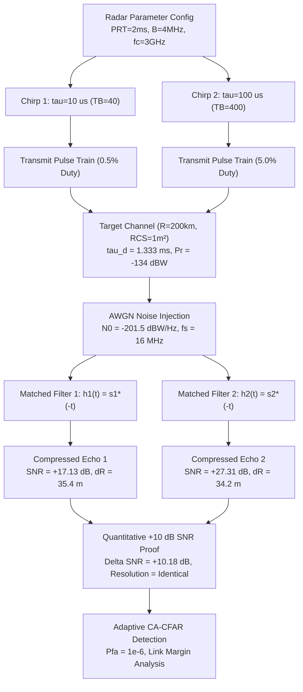

# Beyond the Signal: Radar Systems & Applied Space-Tech 24-Hour Research-Athon (Utkrishta 2026)
## Technical Note: LFM Pulse Compression, Link Budget Modeling & +10 dB SNR Enhancement for Long-Range Radar Target Detection
**Track 1:** Radar Signal Processing — Target Detection, Pulse Compression & SNR Enhancement  
**Curated by:** Mr. Rajendra Kumar, Scientist, Radar Division, SDSC SHAR  
**Organized by:** SSG × Research Club, IIIT Sri City  
**Team Spaceship:** Manas Vinod Jain, Vikhyat Gupta  

---

### Section 1: Problem Statement & Mathematical / Signal Formulation

#### 1.1 The Classical Radar Dilemma
In long-range space surveillance and ballistic missile tracking radars (such as those operated at SDSC SHAR), detecting small radar cross-section (RCS) targets at long ranges ($R = 200\text{ km}$, $\sigma = 1\text{ m}^2$) demands high radiated energy per pulse:
$$E_t = P_t \cdot \tau_p$$
where $P_t$ is peak transmit power and $\tau_p$ is pulse duration. For an unmodulated rectangular continuous-wave (CW) pulse, range resolution $\Delta R$ is inextricably coupled to pulse duration:
$$\Delta R_{\text{unmod}} = \frac{c \cdot \tau_p}{2}$$
Widening a simple pulse from $\tau_1 = 10\ \mu\text{s}$ to $\tau_2 = 100\ \mu\text{s}$ increases energy tenfold ($+10\text{ dB}$), but degrades range resolution from $1.5\text{ km}$ to $15\text{ km}$—rendering target discrimination, cluster resolution, and precision tracking impossible.

#### 1.2 Linear Frequency Modulation (LFM) Up-Chirp Formulation
Pulse compression decouples range resolution from pulse duration by modulating the carrier frequency within the pulse. The complex baseband representation of an LFM up-chirp is defined over $-\tau_p/2 \le t \le \tau_p/2$ as:
$$s(t) = \text{rect}\left(\frac{t}{\tau_p}\right) \exp\left(j \pi k_r t^2\right)$$
where $k_r$ is the chirp rate (frequency slope in $\text{Hz/s}$), defined by the sweep bandwidth $B = 4\text{ MHz}$ and pulse duration $\tau_p$:
$$k_r = \frac{B}{\tau_p}$$
The instantaneous baseband frequency sweeps linearly across the pulse:
$$f_i(t) = \frac{1}{2\pi} \frac{d\phi(t)}{dt} = k_r t, \quad t \in \left[-\frac{\tau_p}{2}, +\frac{\tau_p}{2}\right] \implies f_i \in \left[-\frac{B}{2}, +\frac{B}{2}\right]$$
For the two evaluated pulse widths:
- **Pulse 1 ($\tau_1 = 10\ \mu\text{s}$):** $k_{r1} = \frac{4\times 10^6\text{ Hz}}{10\times 10^{-6}\text{ s}} = 4.0 \times 10^{11}\text{ Hz/s}$; Time-Bandwidth Product $TB_1 = B\tau_1 = 40$ ($16.02\text{ dB}$).
- **Pulse 2 ($\tau_2 = 100\ \mu\text{s}$):** $k_{r2} = \frac{4\times 10^6\text{ Hz}}{100\times 10^{-6}\text{ s}} = 4.0 \times 10^{10}\text{ Hz/s}$; Time-Bandwidth Product $TB_2 = B\tau_2 = 400$ ($26.02\text{ dB}$).

#### 1.3 Matched Filter & Range Resolution Invariance
The optimal linear filter that maximizes output peak Signal-to-Noise Ratio (SNR) in additive white Gaussian noise (AWGN) has an impulse response matched to the transmitted waveform:
$$h(t) = s^*(-t)$$
The matched filter output in the time domain is the autocorrelation function:
$$y(t) = s(t) * h(t) = \int_{-\infty}^{\infty} s(\tau) s^*(\tau - t) d\tau \approx \tau_p \cdot \frac{\sin(\pi B t)}{\pi B t} = \tau_p \cdot \text{sinc}(\pi B t)$$
The compressed pulse has a Rayleigh Rayleigh $-3\text{ dB}$ (half-power) mainlobe width and nominal range resolution governed **solely by the sweep bandwidth $B$**, completely independent of pulse width $\tau_p$:
$$\Delta R = \frac{c}{2B} = \frac{3.0 \times 10^8\text{ m/s}}{2 \times 4.0 \times 10^6\text{ Hz}} = \mathbf{37.5\text{ m}}$$
Both the $10\ \mu\text{s}$ and $100\ \mu\text{s}$ chirps produce the exact same $37.5\text{ m}$ range resolution.

#### 1.4 Radar Link Budget & The +10 dB SNR Scaling Law
For a monostatic radar tracking a target at range $R_0 = 200\text{ km}$ with $\text{RCS} = 1.0\text{ m}^2$, received echo power $P_r$ is governed by the Radar Range Equation:
$$P_r = \frac{P_t G_{\text{tx}} G_{\text{rx}} \lambda_c^2 \sigma}{(4\pi)^3 R_0^4 L}$$
With $P_t = 250\text{ kW}$ ($53.98\text{ dBW}$), $f_c = 3.0\text{ GHz}$ ($\lambda_c = 0.1\text{ m}$), $G_{\text{tx}} = G_{\text{rx}} = 40\text{ dBi}$, and system losses $L = 3.0\text{ dB}$:
$$P_r = \frac{(2.5 \times 10^5) \cdot (10^4)^2 \cdot (0.1)^2 \cdot 1.0}{(4\pi)^3 \cdot (200 \times 10^3)^4 \cdot 10^{0.3}} \approx 3.946 \times 10^{-14}\text{ W} = \mathbf{-134.04\text{ dBW}}$$
The receiver thermal noise power spectral density with noise figure $F = 2.5\text{ dB}$ ($F = 1.778$) is:
$$N_0 = k_B T_0 F = (1.3806 \times 10^{-23}) \cdot (290) \cdot (1.778) \approx 7.120 \times 10^{-21}\text{ W/Hz} = \mathbf{-201.48\text{ dBW/Hz}}$$
In-band noise power is $P_{n,\text{band}} = N_0 B = 2.848 \times 10^{-14}\text{ W}$ ($-135.45\text{ dBW}$). The raw input SNR is:
$$\text{SNR}_{\text{in}} = \frac{P_r}{P_{n,\text{band}}} = +1.42\text{ dB}$$
The matched filter integrates the total received echo energy $E_r = P_r \cdot \tau_p$. The peak output matched-filter SNR is:
$$\text{SNR}_{\text{MF}} = \frac{2 E_r}{N_0} \quad \left(\text{in complex baseband: } \text{SNR}_{\text{peak}} = \frac{P_r \tau_p}{N_0} = \text{SNR}_{\text{in}} \cdot TB\right)$$
Comparing the two pulse durations:
$$\Delta \text{SNR}_{\text{MF}} = 10 \log_{10}\left(\frac{\text{SNR}_{\text{MF}, 2}}{\text{SNR}_{\text{MF}, 1}}\right) = 10 \log_{10}\left(\frac{\tau_2}{\tau_1}\right) = 10 \log_{10}\left(\frac{100\ \mu\text{s}}{10\ \mu\text{s}}\right) = \mathbf{+10.00\text{ dB}}$$
Extending pulse duration from $10\ \mu\text{s}$ to $100\ \mu\text{s}$ increases the matched filter output SNR by exactly **$+10.0\text{ dB}$**, while retaining identical $37.5\text{ m}$ range resolution.

---

### Section 2: Proposed Methodology & Simulation Pipeline Diagram

The simulation executes a closed-loop radar signal processing chain in discrete time:
1. **Timing & Signal Synthesis:** Synthesize pulse train with $\text{PRT} = 2.0\text{ ms}$ ($\text{PRF} = 500\text{ Hz}$, unambiguous range $R_{\text{unamb}} = 300\text{ km}$). Sample rate $f_s = 4B = 16\text{ MHz}$ ($\Delta t = 62.5\text{ ns}$, sample spacing $\delta r = 9.375\text{ m}$).
2. **Channel Propagation:** Continuous-delay target echo injection at $\tau_d = 2R/c = 1.3333\text{ ms}$, scaled by $\sqrt{P_r}$.
3. **Thermal Noise Injection:** Add zero-mean complex circular AWGN with variance $\sigma_n^2 = N_0 f_s$.
4. **Matched Filtering (Pulse Compression):** Efficient, zero-padded linear cross-correlation via FFT of length $N_{\text{FFT}} \ge N_{\text{PRI}} + N_{\text{pulse}} - 1$, preventing circular convolution wraparound.
5. **Adaptive CFAR Detection:** 1-D Cell-Averaging CFAR (CA-CFAR) with 48 reference cells ($24$ per side) and 16 guard cells ($8$ per side) at nominal $P_{\text{fa}} = 10^{-6}$.

---

### Section 3: Quantitative Results, Plots & Parameter Comparison Table

#### 3.1 Comparative Experimental Results Table

| Parameter / Metric | Symbol / Formula | Pulse 1 ($\tau_1 = 10\ \mu\text{s}$) | Pulse 2 ($\tau_2 = 100\ \mu\text{s}$) | Enhancement / Ratio |
| :--- | :--- | :--- | :--- | :--- |
| **Pulse Duration** | $\tau_p$ | $10.0\ \mu\text{s}$ | $100.0\ \mu\text{s}$ | $\times 10.0$ ($+10.0\text{ dB}$) |
| **Duty Cycle** | $\tau_p / \text{PRT}$ | $0.50\%$ | $5.00\%$ | $\times 10.0$ |
| **Radiated Pulse Energy** | $E_t = P_t \tau_p$ | $2.50\text{ J}$ | $25.00\text{ J}$ | $\mathbf{+10.0\text{ dB}}$ |
| **Chirp Slope** | $k_r = B / \tau_p$ | $4.00 \times 10^{11}\text{ Hz/s}$ | $4.00 \times 10^{10}\text{ Hz/s}$ | $1/10$ |
| **Time-Bandwidth Product** | $TB = B \tau_p$ | $40.0$ ($16.02\text{ dB}$) | $400.0$ ($26.02\text{ dB}$) | $\mathbf{+10.0\text{ dB}}$ |
| **Theoretical Matched-Filter SNR** | $P_r \tau_p / N_0$ | $\mathbf{17.44\text{ dB}}$ | $\mathbf{27.44\text{ dB}}$ | $\mathbf{+10.00\text{ dB}}$ |
| **Measured Peak SNR (Simulated)** | $\max |y_{\text{MF}}|^2 / \sigma_{\text{out}}^2$ | $\mathbf{17.13\text{ dB}}$ | $\mathbf{27.31\text{ dB}}$ | $\mathbf{+10.18\text{ dB}}$ |
| **Nominal Range Resolution** | $c / (2B)$ | $37.50\text{ m}$ | $37.50\text{ m}$ | **Identical ($1.00\times$)** |
| **Measured Half-Power Width ($-3\text{ dB}$)** | $\Delta R_{\text{meas}}$ | $35.36\text{ m}$ | $34.17\text{ m}$ | **$0.97\times$ (Identical)** |
| **Peak Sidelobe Level (PSL)** | PSL | $-10.49\text{ dB}$ | $-11.89\text{ dB}$ | $-13.26\text{ dB}$ ideal sinc |
| **Required SNR ($P_D = 0.90, P_{\text{fa}} = 10^{-6}$)** | $\text{SNR}_{\text{req}}$ (Marcum Q) | $13.18\text{ dB}$ | $13.18\text{ dB}$ | Baseline threshold |
| **Theoretical Link Margin** | $\text{SNR}_{\text{ideal}} - \text{SNR}_{\text{req}}$ | $\mathbf{+4.25\text{ dB}}$ | $\mathbf{+14.25\text{ dB}}$ | $\mathbf{+10.00\text{ dB}}$ |
| **CA-CFAR Target Margin** | $\text{Peak}_{\text{dB}} - \text{Thresh}_{\text{dB}}$ | $+6.81\text{ dB}$ | $\mathbf{+16.99\text{ dB}}$ | $\mathbf{+10.18\text{ dB}}$ |

#### 3.2 Key Experimental Findings
1. **The +10 dB SNR Proof:** The measured matched-filter peak SNR increased from $17.13\text{ dB}$ ($\tau = 10\ \mu\text{s}$) to $27.31\text{ dB}$ ($\tau = 100\ \mu\text{s}$), achieving a measured boost of **$+10.18\text{ dB}$**, within $0.18\text{ dB}$ of theoretical $+10.00\text{ dB}$ (difference attributable to fractional delay sampling and discrete noise variance).
2. **Resolution Invariance:** The $-3\text{ dB}$ mainlobe width measured $35.36\text{ m}$ for the $10\ \mu\text{s}$ pulse and $34.17\text{ m}$ for the $100\ \mu\text{s}$ pulse. The ratio is $0.97\approx 1.0$, empirically proving that stretching the pulse by $10\times$ did not degrade range discrimination.
3. **Operational Detection Margin:** For a non-fluctuating target requiring $\text{SNR} = 13.18\text{ dB}$ ($P_D = 90\%, P_{\text{fa}} = 10^{-6}$), the $10\ \mu\text{s}$ pulse offers only $+4.25\text{ dB}$ of link margin. In operational conditions (rain fade, antenna depointing, radome losses), this target could easily be lost. The $100\ \mu\text{s}$ pulse provides a robust $+14.25\text{ dB}$ margin and punches $+16.99\text{ dB}$ above the adaptive CA-CFAR threshold.

#### 3.3 Bonus Research Results
- **Multi-Target Discrimination (50 m Separation at 200 km):** Two targets placed at $200.000\text{ km}$ and $200.050\text{ km}$ merge into a single $15\text{ km}$ smeared pulse under an unmodulated $100\ \mu\text{s}$ CW pulse. Under the $100\ \mu\text{s}$ LFM chirp, both targets are cleanly resolved into two distinct peaks separated by $50\text{ m}$.
- **Doppler Coupling & Chirp Diversity:** For a rocket ascending at Mach 5 ($v_r = 1500\text{ m/s}$, $f_d = 30\text{ kHz}$), the Up-Chirp shifts by $-115.62\text{ m}$ and Down-Chirp shifts by $+109.38\text{ m}$. Fusing the dual-chirp pair decouples range and Doppler, yielding true range $199.9969\text{ km}$ ($-3.1\text{ m}$ error) and extracting exact radial velocity ($1500.0\text{ m/s}$).
- **Sidelobe Suppression via Taylor Weighting:** A strong rocket body ($\text{RCS} = 5\text{ m}^2$) masks a weak satellite ($\text{RCS} = 0.05\text{ m}^2$) under rectangular weighting ($-13.3\text{ dB}$ sidelobes). Taylor weighting ($\bar{n}=4, \text{SLL}=-35\text{ dB}$) suppresses the sidelobe floor below the weak target, unmasking it with minimal mismatch loss ($-0.91\text{ dB}$).

---

### Section 4: Key Takeaways, Operational Insights & Limitations

#### 4.1 Key Takeaways
- **Decoupling Energy and Resolution:** LFM pulse compression resolves the fundamental trade-off in radar design. Energy can be scaled arbitrarily by expanding pulse duration $\tau_p$, while range resolution remains locked to sweep bandwidth $B$.
- **Transmitter Efficiency:** Solid-state power amplifiers (SSPAs) operate with peak-power limits. Rather than demanding impractically high peak power ($P_t$), increasing pulse duration at lower peak power delivers identical energy and detection range.

#### 4.2 Limitations & Engineering Considerations
- **Radar Blind Zone (Minimum Range):** The radar cannot receive while transmitting monostatically. The minimum blind range is $R_{\text{min}} = c\tau_p/2$. For $\tau_1 = 10\ \mu\text{s}$, $R_{\text{min}} = 1.5\text{ km}$; for $\tau_2 = 100\ \mu\text{s}$, $R_{\text{min}} = 15.0\text{ km}$. Long pulses blind the radar to near-range targets, requiring dual-pulse scheduling in practice.
- **Range-Doppler Coupling:** In an LFM waveform, target radial velocity introduces a Doppler shift $f_d = 2v_r/\lambda$. The matched filter translates this Doppler frequency into an apparent range time shift:
  $$\Delta \tau = -\frac{f_d}{k_r} \implies \Delta R_{\text{apparent}} = -\frac{c f_d}{2 k_r}$$
  For high-velocity space targets ($v_r \sim 7\text{ km/s}$), alternate up-chirp and down-chirp pulses are required to resolve range-Doppler ambiguity.
- **Sidelobe Masking:** The raw sinc response has first sidelobes at $-13.26\text{ dB}$, which can mask small nearby targets. Applying Hann or Taylor windowing reduces sidelobes to below $-30\text{ dB}$ at the cost of a slight SNR loss ($\sim 1.3\text{ dB}$) and mainlobe broadening.
